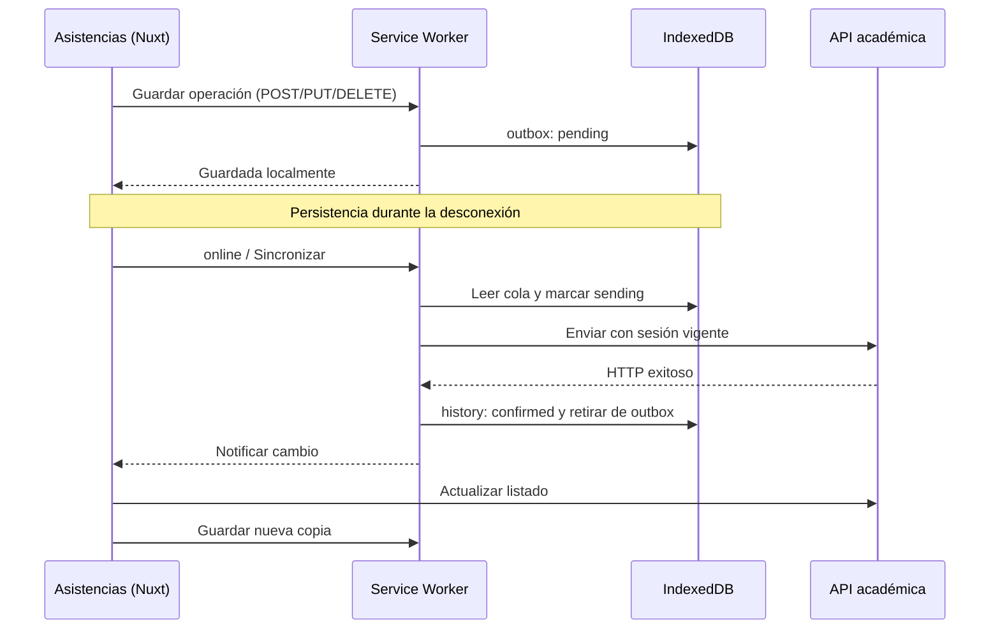

# 🏫 Sistema de Gestión Escolar

Plataforma web para administrar todo lo relacionado con la vida académica y administrativa de un colegio: matrículas, notas, pagos, reportes y comunicación con los apoderados.

---

## ✨ ¿Qué puedes hacer con este sistema?

El sistema está organizado en módulos, cada uno pensado para resolver una parte del día a día del colegio:

### 📝 Matrícula
Gestiona todo el proceso de inscripción de estudiantes: datos del alumno, apoderados, cursos, grados, planes de estudio, secciones, vacantes disponibles, documentos y periodos académicos.

### 🎓 Académico
Controla lo relacionado con la enseñanza: docentes, asignaciones de clases, asistencia, notas y prerrequisitos de cursos.

### 💳 Pagos
Administra las deudas de los estudiantes, los intentos y comprobantes de pago, y la conexión con las pasarelas de pago (como Stripe).

### 📊 Reportes
Genera resúmenes, indicadores y reportes de auditoría para tomar decisiones basadas en datos: asistencia, rendimiento, pagos pendientes, etc.

### 🔔 Notificaciones
Envía avisos a estudiantes y apoderados: plantillas de mensajes, destinatarios y preferencias de notificación (correo, SMS, etc).

### 🔐 Acceso y seguridad
Login, roles de usuario (administrador, docente, apoderado, etc.) y control de quién puede ver o hacer qué dentro del sistema.

---

## ⚙️ Configuración inicial

Antes de usar el sistema, necesitas un archivo `.env` en la raíz del proyecto con las direcciones de cada servicio. Piensa en cada una como el "teléfono" al que la aplicación llama para hacer su trabajo:

```dotenv
NUXT_PUBLIC_LOGIN_API_BASE=https://login-microservice-gfy0.onrender.com
NUXT_PUBLIC_MATRICULA_API_BASE=http://localhost:8082
NUXT_PUBLIC_ACADEMICO_API_BASE=http://localhost:8083
NUXT_PUBLIC_PAGOS_API_BASE=http://localhost:8084
NUXT_PUBLIC_REPORTES_API_BASE=http://localhost:8085
NUXT_PUBLIC_NOTIFICACIONES_API_BASE=http://localhost:8086
NUXT_PUBLIC_STRIPE_KEY=pk_test_xxxxxxxxx
```

| Variable | ¿Para qué sirve? |
|---|---|
| `NUXT_PUBLIC_LOGIN_API_BASE` | Servicio que valida el inicio de sesión y la identidad de los usuarios. Ya está en línea (no requiere instalación local). |
| `NUXT_PUBLIC_MATRICULA_API_BASE` | Servicio del módulo de Matrícula. |
| `NUXT_PUBLIC_ACADEMICO_API_BASE` | Servicio del módulo Académico (notas, asistencias, docentes). |
| `NUXT_PUBLIC_PAGOS_API_BASE` | Servicio del módulo de Pagos. |
| `NUXT_PUBLIC_REPORTES_API_BASE` | Servicio del módulo de Reportes. |
| `NUXT_PUBLIC_NOTIFICACIONES_API_BASE` | Servicio del módulo de Notificaciones. |
| `NUXT_PUBLIC_STRIPE_KEY` | Llave pública para procesar pagos con Stripe (modo de pruebas por defecto). |

> 💡 Los servicios que dicen `localhost` son los que corren en tu propia computadora mientras desarrollas. El de Login ya está publicado y funcionando en internet, por eso apunta a una dirección web en lugar de `localhost`.

---

## 🚀 Cómo iniciar el proyecto

```bash
# Instalar dependencias
npm install

# Copiar el archivo de ejemplo y completarlo con tus datos
cp .env.example .env

# Levantar el proyecto en modo desarrollo
npm run dev
```

Luego abre tu navegador en `http://localhost:3000` para ver la aplicación.

---

## 📁 Estructura del proyecto (resumen)

- **`components/`** → Las pantallas y piezas visuales de cada módulo (matrícula, académico, pagos, reportes, notificaciones).
- **`composables/`** → Conexiones reutilizables hacia cada servicio (matrícula, académico, pagos, etc.).
- **`pages/`** → Las páginas que ve el usuario final (login, dashboard, perfil, ajustes, etc.).
- **`stores/`** → Manejo de la sesión y datos del usuario autenticado.
- **`middleware/`** → Reglas de acceso (por ejemplo, quién puede entrar a qué página).
- **`layouts/`** → Diseños generales de la aplicación (con o sin menú de navegación).

---

## 🤝 Soporte

Si tienes dudas sobre algún módulo o necesitas ayuda para configurarlo, contacta al equipo de desarrollo.

## Comando para adaptar cada microservicio a la sincronización PWA

Copiar **un comando** y ejecutarlo en PowerShell desde la carpeta del repositorio
del microservicio correspondiente. Los comandos abren Codex para implementar y
probar los cambios; requieren Codex CLI instalado y autenticado. Se usa `codex.cmd`
para evitar el bloqueo de scripts de PowerShell.

El Service Worker y la IndexedDB pertenecen al frontend Nuxt. Estos comandos
preparan el contrato de los backends para recibir operaciones diferidas. La
implementación actual del frontend cubre Asistencias; ampliar los otros módulos
en Nuxt sigue siendo necesario para usar esos contratos desde sus pantallas.

### Login

```powershell
codex.cmd "Adapta este microservicio Login para la sincronizacion PWA del frontend Thales. Lee AGENTS.md e inspecciona la implementacion antes de modificarla. Conserva el contrato de autenticacion actual; verifica expiracion y validacion de JWT y respuestas HTTP 401/403 consistentes. Permite al frontend recuperar la identidad y permisos vigentes al reconectar usando el endpoint existente o documenta el contrato que falte. No habilites autenticacion offline ni omitas controles de acceso. Configura CORS por origen para Authorization y los endpoints necesarios. Agrega pruebas relevantes y documenta en README el contrato de reconexion, configuracion y comandos de prueba. Implementa los cambios sin inventar endpoints existentes."
```

### Matrícula

```powershell
codex.cmd "Adapta este microservicio Matricula para recibir operaciones diferidas de una PWA. Lee AGENTS.md e inspecciona rutas, entidades y transacciones reales. Implementa Idempotency-Key persistente por usuario, metodo y ruta: misma clave y cuerpo devuelve el resultado original sin duplicar; distinto cuerpo devuelve 409; protege solicitudes concurrentes. Verifica autenticacion y permisos antes de recuperar resultados previos. Aplica control de concurrencia y validacion transaccional de vacantes para evitar sobrecupos y matriculas duplicadas; conserva las reglas existentes. Documenta el contrato de versiones y conflictos para el frontend y habilita en CORS los encabezados necesarios por origen. Agrega pruebas de reenvio, concurrencia y conflictos, y actualiza README con ejemplos y comandos ejecutables."
```

### Académico

```powershell
codex.cmd "Adapta este microservicio Academico para sincronizacion PWA de asistencias, notas y las demas operaciones que realmente existan y sean aptas para envio diferido. Lee AGENTS.md y revisa los contratos reales. Implementa Idempotency-Key persistente por usuario, metodo y ruta, con comprobacion de cuerpo y proteccion concurrente, para impedir duplicados al reenviar. Verifica permisos antes de devolver resultados previos. Implementa control de version para no sobrescribir silenciosamente cambios posteriores; devuelve un conflicto HTTP documentado. Conserva validaciones academicas y transacciones existentes. Configura CORS por origen para los encabezados necesarios. Agrega pruebas de reenvio, versiones, sesion vencida y concurrencia. Documenta en README ejemplos, contrato para Nuxt y comandos de prueba."
```

### Pagos

```powershell
codex.cmd "Adapta este microservicio Pagos para convivir con una PWA. Lee AGENTS.md e inspecciona endpoints y pasarelas reales. Identifica consultas aptas para copia local y documenta su vigencia. Exige conexion para cobrar o confirmar pagos; nunca consideres un registro local como pago confirmado. Implementa idempotencia persistente y concurrente en las operaciones financieras existentes, por usuario, ruta y cuerpo, coordinada con la pasarela si esta lo permite. Verifica permisos antes de recuperar resultados previos. Protege webhooks duplicados y documenta como consultar el resultado de un cobro incierto antes de reintentarlo. Configura CORS por origen segun el contrato. Agrega pruebas de duplicados y estados inciertos y actualiza README con ejemplos y comandos de prueba."
```

### Reportes

```powershell
codex.cmd "Adapta este microservicio Reportes para una PWA. Lee AGENTS.md e inspecciona las rutas reales. Documenta e implementa cuando corresponda un contrato de consulta con fecha de generacion, filtros y version o ETag para que Nuxt distinga una copia local de datos actualizados. Conserva permisos y aislamiento por usuario. La generacion que necesite datos del servidor requiere conexion; si hay solicitudes diferidas de generacion, implementa Idempotency-Key persistente y proteccion concurrente para no duplicar trabajos. No afirmes que se genera un reporte nuevo offline en el backend. Configura CORS por origen y expone los encabezados de version necesarios. Agrega pruebas relevantes y actualiza README con ejemplos del contrato y comandos ejecutables."
```

### Notificaciones

```powershell
codex.cmd "Adapta este microservicio Notificaciones para recibir solicitudes diferidas de una PWA. Lee AGENTS.md e inspecciona rutas, persistencia y proveedores reales. Implementa Idempotency-Key persistente por usuario, metodo, ruta y cuerpo con proteccion concurrente; verifica permisos antes de recuperar resultados previos. Evita duplicar envios por reintentos mediante una bandeja transaccional y deduplicacion soportada por el proveedor; documenta los limites reales si no puede garantizarse una sola entrega. Distingue aceptada, pendiente, enviada y fallida sin afirmar envio offline. Aplica control de version a preferencias o plantillas editables. Configura CORS por origen para el contrato. Agrega pruebas de reenvios y fallos y actualiza README con ejemplos y comandos ejecutables."
```

## PWA: trabajo sin conexión y sincronización de asistencias

La implementación offline tiene alcance explícito en **Académico -> Asistencias**
(`/dashboard/academico?modulo=asistencias`). Los demás módulos siguen requiriendo
conexión. Nuxt por sí solo no proporciona persistencia offline.

### Activación y prueba local de la PWA

Desde la raíz del proyecto, ejecutar estos comandos en orden. Esperar a que
termine la compilación antes de iniciar preview:

```bash
npm run build
npm run preview
```

Esto permite usar y probar la PWA en tu computadora antes de desplegarla.
`build` genera la compilación y `preview` la sirve localmente; estos comandos
no publican la aplicación. Mantener la terminal de preview abierta mientras se usa.
Si se modifica el código, detener preview con `Ctrl+C` y repetir ambos comandos.

En PowerShell, si la política de scripts impide ejecutar npm, usar `npm.cmd`.
Abrir el origen indicado por preview (normalmente http://localhost:3000).
En un despliegue se requiere HTTPS; localhost sirve para la prueba local.
El Service Worker se registra al ejecutar la compilación con preview o en un
despliegue: `npm run dev` no activa esta funcionalidad. Iniciar sesión real,
entrar en Asistencias y esperar el aviso
**PWA activa**. Cargar el listado al menos una vez con conexión y recargar la página
para comprobar que está controlada por el worker.

`public/manifest.webmanifest` define nombre, inicio e icono SVG. La disponibilidad
del botón de instalación depende del navegador; no es un requisito para trabajar
offline. `scripts/pwa-assets.mjs`, ejecutado al preparar los recursos de Nitro, genera la lista y
versión de recursos de la interfaz que `public/sw.js` precarga en Cache Storage.
El dashboard se renderiza en el cliente y su HTML inicial no contiene datos de usuario.
Se precarga la ruta de asistencias; otras páginas visitadas se almacenan al navegar
por documento. Una página no almacenada muestra `offline.html` al desconectarse.

### Flujo de datos

1. **Con conexión:** la API entrega el listado de asistencias. El frontend pide al
   Service Worker guardar una copia en IndexedDB mediante mensajes (`MessageChannel`).
2. **Sin conexión:** el listado se obtiene de esa copia y muestra la fecha de lectura
   original. Si nunca se guardó una copia, aparece un error explícito.
3. **Guardar o eliminar:** con la PWA activa, POST, PUT y DELETE de asistencias se
   guardan primero en la cola local, incluso con conexión. La interfaz confirma
   almacenamiento local, no aceptación del servidor. Las operaciones se ven en el
   panel de pendientes; el listado mantiene la última copia confirmada, sin inventar
   IDs del servidor ni presentar registros pendientes como confirmados.
4. **Reconexión:** el evento `online`, el botón Sincronizar y una comprobación cada
   30 segundos con el componente abierto solicitan al Service Worker procesar la cola.
   También se registra Background Sync si está disponible. El worker envía las
   operaciones en serie usando la sesión vigente, comprueba la respuesta HTTP,
   registra la confirmación y retira la operación de la cola. La pantalla vuelve
   a consultar la API y actualiza la copia local.
5. **Errores:** HTTP 401/403 deja el estado `auth`, a la espera de una nueva sesión;
   HTTP 409, 400 y otros errores HTTP dejan `blocked` con el detalle. Un envío
   interrumpido deja `uncertain`. Un cierre del worker durante `sending` se trata
   también como incierto. Las operaciones posteriores de esa cuenta quedan retenidas.
   Revisar el servidor y luego descartar la operación local desde el panel; corregir
   o registrar nuevamente solo después de esa revisión.



### Almacenamiento, sesión y límites

En DevTools -> Application -> IndexedDB -> **thales-offline**:

| Almacén | Contenido |
|---|---|
| `snapshots` | último listado exitoso y `savedAt`, separado por cuenta y URL de API. |
| `outbox` | ID local, cuenta, API, ruta, método, cuerpo, fecha y estado de cada operación. |
| `history` | Operaciones confirmadas y `syncedAt`, para trazabilidad técnica local. |

Los tokens no se guardan en estos almacenes: el worker los mantiene en memoria,
recibidos de la sesión de una pestaña abierta. Al cerrar sesión se invalida esa
sesión en el worker; las operaciones de otra cuenta no se envían ni se muestran.
Los datos locales permanecen para recuperar pendientes al volver a iniciar sesión.
Esto es separación funcional por cuenta, no cifrado de IndexedDB: no usar un perfil
compartido del navegador para datos escolares sensibles. Borrar datos del sitio
elimina también pendientes e historial; el almacenamiento puede ser desalojado
por el navegador. El historial local no sustituye la auditoría del servidor.

Background Sync tiene compatibilidad limitada y requiere contexto seguro:
[documentación de MDN](https://developer.mozilla.org/en-US/docs/Web/API/Background_Synchronization_API).
No se promete sincronizar con todas las pestañas cerradas: si el worker reinicia,
necesita recibir nuevamente la sesión desde la aplicación. Reabrir Asistencias e
iniciar sesión permite continuar. No hay inicio de sesión nuevo sin conexión;
solo se restaura una sesión previamente almacenada.

El backend de este repositorio no está disponible para implementar claves de
idempotencia o control de versiones. Por ello **no se reenvía automáticamente una
operación cuyo resultado sea incierto**, ni se garantiza exactamente una entrega
ante caídas. Tampoco hay combinación automática de cambios simultáneos: un HTTP
409 se conserva para resolución manual; si el servidor no detecta conflictos,
aplica su propia política. Los errores de red/CORS deben diagnosticarse antes de
volver a registrar una operación. Pagos y matrículas no se encolan.

### Prueba reproducible y evidencias para el Capítulo V / anexos

Usar una cuenta y datos de prueba en una API académica accesible, con CORS habilitado
para el origen del frontend. Registrar fecha, navegador/versión, URL de frontend,
URL de API y versión del código. No incluir tokens ni información real de menores
en las capturas o archivos HAR.

| Caso | Procedimiento | Resultado esperado y evidencia a capturar |
|---|---|---|
| PWA-01 | Compilar, iniciar preview, abrir Asistencias con sesión y conexión. | Application -> Service Workers: `sw.js` activado y controlando el cliente; Manifest cargado; Cache Storage con recursos. |
| PWA-02 | Cargar el listado; revisar IndexedDB; desconectar la red y recargar Asistencias. | Interfaz disponible, aviso sin conexión y listado de `snapshots` con fecha. Capturar pantalla y almacén. |
| PWA-03 | Crear asistencia usando IDs válidos, sin conexión. | Mensaje de guardado local; `outbox` con POST en `pending`; sin confirmación del servidor. Capturar cuerpo anonimizado, ID local y hora. |
| PWA-04 | Mantener Asistencias abierta y reconectar. | Worker envía a la API; respuesta HTTP exitosa; se vacía ese pendiente; `history` contiene `confirmed` y `syncedAt`; listado actualizado. Capturar Network, IndexedDB y consultar el mismo registro en el servidor. |
| PWA-05 | Encolar otra operación offline, cerrar y reabrir el navegador, reconectar e iniciar sesión si hace falta. | El pendiente persiste; al recibir sesión el worker continúa. Capturar antes/después. |
| PWA-06 | Provocar HTTP 401/403 con sesión inválida o vencida. | Estado `auth`, sin pérdida del cuerpo. Iniciar una nueva sesión válida y comprobar continuidad. |
| PWA-07 | Provocar HTTP 409 o validación 400 desde la API de prueba. | Estado `blocked`, detalle visible y siguientes operaciones retenidas. Resolver manualmente. |
| PWA-08 | Cortar conexión durante un envío ya iniciado. | `uncertain` (o `sending` hasta recuperar el worker y consultar estado), sin reenvío automático. Verificar el servidor antes de descartar. |
| PWA-09 | Crear pendiente con cuenta A, cerrar sesión e ingresar con B. | B no ve ni envía pendientes/copia de A. Volver a A y verificar recuperación. |

Para simular la desconexión completa, desconectar la red del equipo o activar el
modo offline tanto para la página como para el worker en DevTools. El modo offline
solo de una pestaña puede no afectar las peticiones iniciadas por el worker.
En Chromium, Application -> Background services -> Background Sync permite registrar
los eventos disponibles. Si la petición al backend falla por CORS, no es una
confirmación de trabajo offline correcto: primero corregir CORS y repetir la prueba.

Guardar en anexos capturas numeradas, respuestas HTTP y confirmación del servidor,
y completar esta tabla con mediciones reales:

| Caso | Resultado obtenido | Tiempo de sincronización | Evidencia | Aprobado |
|---|---|---|---|---|
| PWA-01 a PWA-09 (una fila por caso) | Pendiente de ejecución en navegador con API de prueba | Por medir | Por adjuntar | Por verificar |

Para medir sincronización, usar la hora de reconexión y `history.syncedAt`. No
presentar los resultados esperados de esta guía como resultados experimentales.
La observación académica se podrá dar por subsanada cuando estas evidencias reales
están incorporadas al Capítulo V o los anexos.

### Verificación automatizada

```bash
node --test tests/offline-worker.test.mjs
npm run build
```

Las pruebas del protocolo del worker verifican envío único frente a solicitudes
simultáneas, confirmación y retiro de cola, interrupción incierta sin reintento,
bloqueo por conflicto, aislamiento por cuenta, sesión vencida y recuperación de
envíos interrumpidos. Utilizan dobles de IndexedDB y fetch; no reemplazan las pruebas
reales de persistencia, instalación, caché y reconexión de la tabla anterior.

Verificación local realizada: **7 pruebas automatizadas aprobadas**, compilación
de producción exitosa y comprobación HTTP del worker y sus **43 recursos de precaché**
aprobada. El build emite advertencias de CSS de Vuetify, sourcemaps, tamaño de chunks
y dependencias; estas no impidieron la compilación. Las pruebas en navegador con una
API real y sus capturas siguen pendientes; no se han sustituido por resultados simulados.

Con `npm run preview` ejecutándose, `node scripts/verify-pwa.mjs` comprueba por HTTP
el archivo de precaché, el Service Worker, todos los recursos y la ruta de asistencias.
Si preview usa otro puerto, configurar `PWA_TEST_ORIGIN` con ese origen.


### Correccion de la cola de Matricula

EstudiantesModulo y MatriculasCrud guardan POST/PUT/DELETE en IndexedDB antes
 del primer envio. La interfaz distingue pendientes de confirmaciones HTTP.
La sesion de cada microservicio se mantiene separada; el plugin reintenta cada
15 segundos con la aplicacion abierta y una sesion vigente, incluso si solo
se cae el microservicio y navigator.onLine sigue siendo true. Tambien se intenta
al reconectar, activar el worker y abrir nuevamente la aplicacion. Los intentos
pendientes sobreviven a una recarga. HTTP 401/403 espera nuevas credenciales;
400/409/422 queda bloqueado con detalle visible. Los fallos temporales y de red
en estas dos pantallas vuelven a pendiente. Asistencias conserva su politica
previa de no reenviar automaticamente una entrega incierta.

Requiere build de produccion (`npm run build`, `npm run preview`), HTTPS o localhost,
y un Service Worker activo. No se garantiza ejecucion inmediata con la aplicacion
cerrada: Background Sync depende del navegador y las credenciales no se persisten.
El reenvio de Matricula ofrece entrega al menos una vez: sin idempotencia en el
backend, una respuesta perdida despues de guardar puede producir duplicados.
La garantia de una unica escritura requiere implementar y conectar el contrato
Idempotency-Key descrito arriba; este repositorio no contiene el microservicio.
No extender esta garantia a otros submodulos de Matricula que siguen usando HTTP.

Prueba manual: con la PWA activa, detener Matricula, guardar un estudiante o una
matricula y comprobar el aviso de pendiente. Recargar, restablecer el servicio
y esperar el siguiente intento (15 segundos sin solicitudes en curso). Verificar
confirmacion visible y existencia del registro en el servidor. Repetir con un
409 y comprobar que el error permanece visible y no se reintenta.
